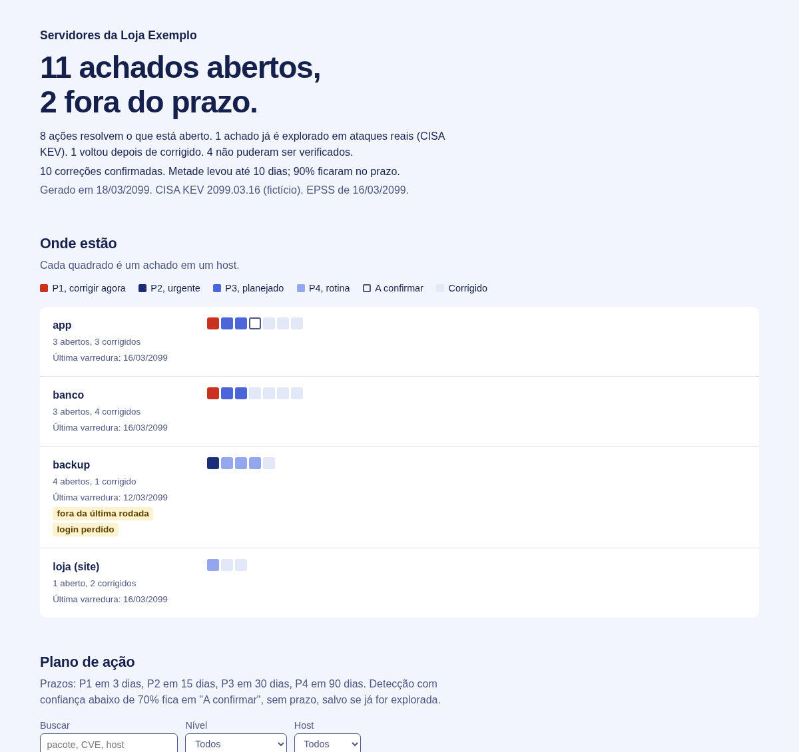

# openvas-tratativas

Transforma os relatórios XML do OpenVAS/Greenbone em um plano de correção que se acompanha de rodada em rodada: o que corrigir primeiro, até quando, o que já foi corrigido de verdade e o que só parece corrigido.

*Turns OpenVAS/Greenbone XML reports into a remediation plan tracked across scans (CISA KEV, EPSS, deadlines, confirmed fixes). Documentation in Portuguese.*



## Por que existe

O scanner entrega uma lista de achados por rodada. Para tratar, faltam três respostas:

- **O que vem primeiro?** A nota CVSS sozinha põe dezenas de itens como críticos. Aqui entram também a exploração confirmada (CISA KEV), a chance de exploração (EPSS) e a confiança da própria detecção (QoD).
- **Quantas tarefas são?** Vinte avisos do mesmo pacote viram uma atualização só.
- **Corrigiu mesmo?** Se o scan caiu no meio, o teste estourou o tempo ou o login no servidor falhou, o achado some do relatório sem ter sido corrigido. Nesses casos ele fica como "não verificado", e não como corrigido.

## Teste em um minuto

Precisa de Python 3.11+ e do [uv](https://docs.astral.sh/uv/).

```bash
git clone https://github.com/TiagoKoakoski/openvas-tratativas
cd openvas-tratativas
uv run tratativas exemplo/rodadas --avisos exemplo/avisos --inteligencia exemplo/inteligencia \
  --config exemplo/config.toml --hoje 2099-03-18 --saida saida
```

Abra `saida/painel.html`. O exemplo é todo inventado: IPs de documentação (RFC 5737), nomes `.example` e CVEs de 2099.

Com Docker, sem rede e sem privilégio:

```bash
docker build -t openvas-tratativas .
mkdir -p saida
docker run --rm --network none --read-only --cap-drop ALL --user "$(id -u):$(id -g)" \
  -v "$PWD/exemplo:/dados:ro" -v "$PWD/saida:/saida" openvas-tratativas \
  /dados/rodadas --avisos /dados/avisos --inteligencia /dados/inteligencia \
  --config /dados/config.toml --hoje 2099-03-18 --saida /saida
```

## Com os seus relatórios

Guarde os XML de todas as rodadas em uma pasta e gere de novo a cada scan. O histórico sai dos próprios arquivos; não há banco de dados.

```bash
uv run tratativas relatorios/ --inteligencia inteligencia --baixar --config config.toml --saida saida
```

| Opção | Para quê |
|---|---|
| `XML ...` | arquivos ou pastas com os relatórios |
| `--saida` | pasta de destino (padrão: `saida`) |
| `--inteligencia` | pasta com `kev.json` e `epss.csv.gz` |
| `--baixar` | atualiza os dois catálogos antes de gerar |
| `--avisos` | pasta `notus/advisories` do feed, para o formato OSP |
| `--config` | prazos, fuso e nome dos hosts ([modelo](exemplo/config.toml)); sem ele, as datas saem em UTC |
| `--hoje` | data usada para calcular atraso |

Formatos aceitos:

- **GMP**: o relatório XML exportado pela interface ou pela API do Greenbone.
- **OSP**: a saída bruta do `ospd-openvas` (`get_scans_response`). Nela, os alertas de pacote vêm sem nome e sem nota; `--avisos` completa.

O que é gerado:

| Arquivo | Uso |
|---|---|
| `painel.html` | plano com filtros, situação por host e evolução; um arquivo só, funciona sem internet |
| `resumo.md` | números e próximas ações, para a gestão |
| `plano.csv` | uma linha por ação, para planilha ou sistema de chamados |
| `dados.json` | tudo, para integrar |

## Como decide

| Nível | Quando | Prazo padrão |
|---|---|---|
| P1 | está no CISA KEV, ou EPSS ≥ 50% com CVSS ≥ 7 | 3 dias |
| P2 | CVSS ≥ 9, ou EPSS ≥ 10% | 15 dias |
| P3 | CVSS ≥ 7 | 30 dias |
| P4 | o restante, inclusive sem nota | 90 dias |
| Confirmar | confiança da detecção abaixo de 70%, fora do KEV | sem prazo |

Cada achado mostra o motivo do nível. Prazos e limites mudam no `config.toml`.

| Estado | Significado |
|---|---|
| novo | apareceu na última varredura do host |
| aberto | continua lá (na primeira varredura do host, tudo entra como aberto) |
| corrigido | sumiu em uma varredura completa e capaz de ver o achado |
| reaberto | voltou depois de corrigido; o prazo recomeça |
| não verificado | sumiu, mas a varredura não prova: incompleta, teste com falha ou sem login |

Detalhes e limites em [docs/como-funciona.md](docs/como-funciona.md).

## Segurança e privacidade

- Nada sai da sua máquina. `--baixar` pega os catálogos inteiros do CISA KEV e do EPSS, então ninguém fica sabendo quais CVEs você tem.
- O XML é lido com `defusedxml`, que recusa entidades externas e expansão em cascata.
- Todo texto do scanner é escapado no HTML e no Markdown; o painel só executa o próprio script (CSP por hash) e o CSV não vira fórmula na planilha.
- O `.gitignore` bloqueia XML e saída. Relatório de scanner mostra como atacar o ambiente: não publique.

## Desenvolvimento

```bash
uv sync
uv run pytest
uv run ruff check . && uv run ruff format --check .
python exemplo/gerar.py   # recria o exemplo
```

Projeto independente, sem vínculo com a Greenbone. OpenVAS e Greenbone são marcas da Greenbone AG. Licença [MIT](LICENSE).
